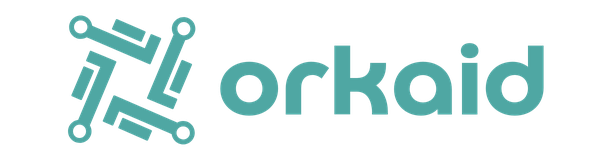

<h1 align="left">
  
</h1>

An independent, open-source hub of professional tools, built in public.

Orkaid is a practitioner-led project by Mihai-Adrian Mateescu, a practising financial accountant. Finance, accounting and compliance are where it starts: the work that actually has to be filed, booked and checked. They are its starting strengths, not the limit of its scope. AI coding agents are part of the development process; they are engineering leverage, not the product. Deterministic domain rules govern every calculation and output. Tests and independent review are evidence that those rules behave as intended; they do not decide a financial result.

XRechnung (German electronic invoicing) is the first flagship. It is the first tool, not the whole project.

## Where things stand

| Part | State |
| --- | --- |
| Website, [orkaid.de](https://orkaid.de) | Live. A static, bilingual (German, English) site. It contains no usable tool yet. |
| XRechnung domain engine | Implemented and integrated in this repository as headless TypeScript code. It creates XRechnung documents in UBL and CII syntax from structured input. |
| XRechnung generator for users | **Not available.** There is no user interface, no download and no hosted generator. The deployed website does not expose one. |
| Maturity | Early software, **not** a production-ready or fully compliant XRechnung generator. The semantic model is not yet declared frozen, so interfaces may still change. There is no public application release. |

The engine's semantic contract carries an explicit identifier. It names the Orkaid contract only, not an XRechnung version and not an application release. The identifier, together with what the engine supports and what it deliberately rejects, is documented in [`src/lib/domain/xrechnung/README.md`](src/lib/domain/xrechnung/README.md), which is the authoritative description.

Input the engine cannot accept is refused, and no document is produced. The result is a list of structured errors, each with a stable code and the path of the offending field. The codes separate several kinds of problem: input outside the supported profile (`unsupported_…`), a malformed or invalid value (for example `invalid_…`), required data that is missing (`missing_…`), and fields the engine does not know (`unknown_field`). An `unsupported_…` error means "not supported by this profile", not "legally invalid". The codes are defined in [`src/lib/domain/xrechnung/document.ts`](src/lib/domain/xrechnung/document.ts).

## How the XRechnung engine is verified, and what that does not show

- **Exact arithmetic.** Amounts are calculated with scaled integers, never binary floating point. The tests compare amounts with independently worked values.
- **Local validation with the official validator.** A local harness runs generated documents through a pinned version of the KoSIT validator and its XRechnung configuration (see [`tools/kosit`](tools/kosit/README.md)). A document passes only if the intended scenario matched, the validator accepted it, and each of its messages is listed in a committed triage file. Deliberately modified control documents must be rejected for the rules they break. The harness does not individually classify every other message that a rejected control document produces.
- **Project-specific rules.** Restrictions that belong to the Orkaid profile, and checks that the validator does not perform, are covered by the project's own tests and not by the validator.
- **Review.** The project's completion criteria require a review by someone other than the implementer. The engine as a whole has not been declared complete.

The claim is narrow: the documents it covers are *accepted by the pinned validator*. That is not legal certification, says nothing about tax correctness, and does not mean that a recipient, for example a public-sector platform, accepts a document. Licensed standards texts were not available for every rule, so no exhaustive verification against them is claimed.

## Building in public

Orkaid is developed in the open, and the process is documented as it happens: research, decisions, engineering trade-offs, failures, fixes and verification. Two complementary records exist:

- **Written development log:** [orkaid.substack.com](https://orkaid.substack.com)
- **Visual development log:** [YouTube, @orkaidbuilds](https://www.youtube.com/@orkaidbuilds)

## Repository layout

| Path | Content |
| --- | --- |
| `src/pages`, `src/layouts`, `src/styles`, `src/i18n` | The static website (Astro). German is the default language; English lives under `/en/`. Interactive Svelte components are planned only where genuine interactivity is needed. |
| `src/lib/domain/xrechnung` | The framework-independent XRechnung domain engine. |
| `tests` | Automated tests, fixtures and golden files. |
| `tools` | Development tooling, including the local KoSIT harness and the dependency-audit gate. |
| `public` | Static assets, including the logo and self-hosted fonts. |

## Development

Use Node `24.20.0` (see `.node-version`) and npm `11.19.0`.

```bash
npm ci
npm run dev        # local preview at http://localhost:4321 (not run by CI)
npm run check      # Astro diagnostics and TypeScript
npm test           # domain and tooling tests
npm run build      # static production build plus output checks
```

Continuous integration runs `npm ci`, `npm run check`, `npm test`, `npm run build` and the dependency-audit gate (`node tools/audit-gate/run.ts`). It does not run `npm run dev`, the KoSIT validation or any deployment.

The KoSIT validation is a separate, opt-in step. It needs Java and the official XRechnung bundle, neither of which is part of the repository; see [`tools/kosit/README.md`](tools/kosit/README.md).

Releasing the website to production is a separate, explicitly authorized step; changes to this repository do not deploy anything.

## License and attribution

Software in this repository is licensed under the [MIT License](LICENSE). The Orkaid name, logos and visual identity are not covered by it; see [`BRAND_ASSETS.md`](BRAND_ASSETS.md). Self-hosted fonts keep their own licenses under [`public/fonts/`](public/fonts/).

If Orkaid code materially contributes to another public implementation, visible credit such as "Based on Orkaid — https://orkaid.de" is appreciated but not required, and is not an additional condition of the MIT License.
