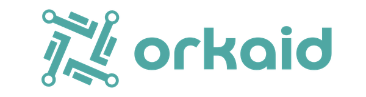

<h1 align="left">
  
</h1>

An independent, open-source hub of professional tools and practical knowledge, built in public.

Orkaid is a practitioner-led project by Mihai-Adrian Mateescu, a practising financial accountant. Finance, accounting and compliance are where it starts: the work that actually has to be filed, booked and checked. They are its starting strengths, not the limit of its scope. AI coding agents are part of the development process; they are engineering leverage, not the product. Deterministic domain rules govern every calculation and output. Tests and independent review are evidence that those rules behave as intended; they do not decide a financial result.

XRechnung (German electronic invoicing) is the first flagship. It is the first tool, not the whole project.

## What this repository contains

| Part | In this repository |
| --- | --- |
| Website | A static, bilingual site (Astro). German is the default; English lives under `/en/`. Home page, tool hub, knowledge section and legal pages. |
| XRechnung generator | A browser-based user interface over the XRechnung domain engine. It creates an invoice (type 380) or a commercial credit note (type 381) and exports it as XRechnung 3.0.2 in UBL 2.1 or UN/CEFACT CII syntax. |
| Knowledge resources | Three guides in German and English: understanding electronic invoices, creating an XRechnung with the generator, and checking and passing on the exported file. |
| XRechnung domain engine | Framework-independent TypeScript in [`src/lib/domain/xrechnung`](src/lib/domain/xrechnung/README.md): the semantic model, exact monetary calculation and the two XML serializers. |

**Implemented, published and deployed are three different states.** Something implemented in this repository is not necessarily published here on GitHub yet, and something published on GitHub is not necessarily deployed. The website at [orkaid.de](https://orkaid.de) is deployed separately, by an explicitly authorized step; a change to this repository deploys nothing. This README therefore describes the code, not what orkaid.de currently serves.

## Versions

Three identities are kept apart:

| Identity | Value | What it names |
| --- | --- | --- |
| Orkaid application release | `v0.1.0` | The version of the website and the generator (also in `package.json`). Published versions are listed under [GitHub Releases](https://github.com/orkaid/orkaid/releases); deployment to orkaid.de is a separate step. |
| Semantic contract | `xrechnung-domain-v1` | The frozen meaning of the domain engine's input and output; see the [domain README](src/lib/domain/xrechnung/README.md). |
| XRechnung specification | 3.0.2 | The standard version the generator writes. Development checks use the pinned KoSIT validator 1.6.3 with the validation configuration 2026-08-31 (see [`tools/kosit`](tools/kosit/README.md)). |

A specific build is identified by its Git commit, not by any of these.

## The XRechnung generator

The generator implements a deliberately limited profile: an ordinary German domestic B2B invoice or credit note in EUR, VAT at 19% and/or 7%, Reverse Charge (§ 13b UStG) per line or the Kleinunternehmer treatment (§ 19 UStG) for the whole invoice, payment of an invoice by credit transfer with an IBAN, and a credit note settled only by a confirmed clearing. Allowances and charges, prepayments, attachments, negative quantities or prices, foreign parties, other currencies, XML import and PDF generation are outside the profile. These are limits of this tool, not statements about what the law, EN 16931 or XRechnung permit. The tool never decides whether § 19 or § 13b UStG applies to a user; that choice stays with the user.

The full profile is documented in [`src/lib/domain/xrechnung/README.md`](src/lib/domain/xrechnung/README.md), the authoritative description. The semantic contract of the engine is frozen as `xrechnung-domain-v1`. That identifier names the Orkaid contract only, not an XRechnung version and not an application release.

Input the engine cannot accept is refused, and no document is produced. The result is a list of structured errors, each with a stable code and the path of the offending field. An `unsupported_…` error means "not supported by this profile", not "legally invalid". The codes are defined in [`src/lib/domain/xrechnung/document.ts`](src/lib/domain/xrechnung/document.ts).

**Local processing.** The generator computes and builds the XML in the browser. The application stores no invoice data and sends none to a server: entries live in the page's memory and are lost when the page is closed or reloaded, and the XML file is handed to the browser as a download. Before in-site navigation would discard a changed form, the tool asks for confirmation; on reload or tab closure only the browser's own prompt is possible. The hosting provider still processes the technical data of every page request; see the privacy notice on the website.

## How it is verified, and what that does not show

- **Exact arithmetic.** Amounts are calculated with scaled integers, never binary floating point. The tests compare amounts with independently worked values.
- **Local validation with the official validator.** A local harness runs generated documents through a pinned version of the KoSIT validator and its XRechnung configuration (see [`tools/kosit`](tools/kosit/README.md)). A document passes only if the intended scenario matched, the validator accepted it, and each of its messages is listed in a committed triage file. Deliberately modified control documents must be rejected for the rules they break. The harness does not individually classify every other message that a rejected control document produces.
- **Project-specific rules.** Restrictions that belong to the Orkaid profile, and checks that the validator does not perform, are covered by the project's own tests and not by the validator.
- **Browser checks.** [`tools/browser-check`](tools/browser-check/) drives the built website in a local Chromium under the production Content-Security-Policy: interface behaviour, focus, layout at many widths, the leave confirmation, and that no request carries invoice data. These checks are not run in CI and do not cover Firefox, Safari, real devices or assistive technology.
- **Review.** The project's completion criteria require a review by someone other than the implementer.

The claim is narrow: the documents it covers are *accepted by the pinned validator*. That is not legal certification, says nothing about tax correctness, and does not mean that a recipient, for example a public-sector platform, accepts a document. Licensed standards texts were not available for every rule, so no exhaustive verification against them is claimed. The generator itself does not run a validator; the knowledge guide on checking an XRechnung explains how users can validate an exported file themselves.

## Building in public

Orkaid is developed in the open, and the process is documented as it happens: research, decisions, engineering trade-offs, failures, fixes and verification.

- **Written development log:** [orkaid.substack.com](https://orkaid.substack.com)
- **Visual development log:** [YouTube, @orkaidbuilds](https://www.youtube.com/@orkaidbuilds)

## Issues and feedback

Bug reports, unclear wording and suggestions are welcome as [GitHub issues](https://github.com/orkaid/orkaid/issues). Please use fictional data only; never attach a real invoice or real personal data.

## Repository layout

| Path | Content |
| --- | --- |
| `src/pages`, `src/layouts` | Routes and page shells of the website, German unprefixed and English under `/en/`. |
| `src/components/platform` | Shared components of the home page, tool hub and knowledge section. |
| `src/components/tools/xrechnung` | The generator's user interface (Svelte), mounted from external scripts because the site's CSP forbids inline scripts. |
| `src/i18n` | German and English interface text, the tool catalog and the knowledge registry. |
| `src/styles` | Design tokens and the shared base styles. |
| `src/lib/domain/xrechnung` | The framework-independent XRechnung domain engine. |
| `tests` | Automated tests, fixtures and golden files. |
| `tools` | Development tooling: the local KoSIT harness, the browser checks and the dependency-audit gate. |
| `public` | Static assets: logo, self-hosted fonts, security headers and the origin part of `robots.txt`. |

## Development

Use Node `24.20.0` (see `.node-version`) and npm `11.19.0`.

```bash
npm ci
npm run dev        # local preview at http://localhost:4321 (not run by CI)
npm run check      # Astro diagnostics and TypeScript
npm test           # domain, interface and tooling tests
npm run build      # static production build plus output checks
node tools/browser-check/rechnungsblatt.ts   # after a build; needs a local Chrome or Chromium
node tools/browser-check/platform.ts         # after a build; needs a local Chrome or Chromium
```

Continuous integration runs `npm ci`, `npm run check`, `npm test`, `npm run build` and the dependency-audit gate (`node tools/audit-gate/run.ts`). It does not run `npm run dev`, the browser checks, the KoSIT validation or any deployment.

The KoSIT validation is a separate, opt-in step. It needs Java and the official XRechnung bundle, neither of which is part of the repository; see [`tools/kosit/README.md`](tools/kosit/README.md).

## License and attribution

The software in this repository is licensed under the [MIT License](LICENSE).

The original text of the knowledge guides (the German and English pages under `src/pages/knowledge/` and `src/pages/en/knowledge/`) is licensed under [Creative Commons Attribution 4.0 International (CC BY 4.0)](https://creativecommons.org/licenses/by/4.0/), to the extent that Orkaid holds the rights to it. The markup and code of those pages remain under the MIT License. Each guide carries its own license notice. CC BY 4.0 requires, among other things, credit to the author (Mihai-Adrian Mateescu, Orkaid), a reference to the license and an indication of changes; it adds no further restriction.

Neither license covers the Orkaid name, logos and visual identity (see [`BRAND_ASSETS.md`](BRAND_ASSETS.md)) or third-party material, such as quoted texts, statutory and standards texts, rule identifiers and validator output, which keep their own terms. Self-hosted fonts keep their own licenses under [`public/fonts/`](public/fonts/). Reuse under either license does not imply endorsement, certification or official Orkaid status.

If Orkaid code materially contributes to another public implementation, visible credit such as "Based on Orkaid — https://orkaid.de" is appreciated but not required, and is not an additional condition of the MIT License.
